# Altocumulus

[](https://github.com/studiome/altocumulus/actions/workflows/ci.yml)
[](.ruby-version)
[](Gemfile)
[](LICENSE)

[English](README.md) | **日本語**

診療科単位で使う、患者・診断・手術・入院の診療台帳アプリケーション。
外来から病棟までの記録を 1 か所にまとめ、**手術枠（elective slot）の消化状況**・
**入院予約から確定までのライフサイクル**・**全変更の監査ログ**を、
ログインした利用者ごとの権限のもとで可視化することに重点を置いています。
既定 50 日分を見渡す**運用カレンダー**をトップページとして、日々の手術・入院件数や
混雑・休日・お知らせをひと目で確認できます。

Rails 8.1 の標準構成（Propshaft + importmap + Turbo/Stimulus）だけで作られており、
Node のビルドパイプラインも外部の DB サーバーも必要ありません。

---

## 目次

- [主な機能](#主な機能)
- [技術スタック](#技術スタック)
- [セットアップ](#セットアップ)
- [設定](#設定)
- [開発コマンドとテスト](#開発コマンドとテスト)
- [ドメインモデル](#ドメインモデル)
- [設計上のポイント](#設計上のポイント)
- [デプロイ](#デプロイ)
- [開発ルール](#開発ルール)
- [ライセンス](#ライセンス)

---

## 主な機能

| 機能 | 画面 | 概要 |
| --- | --- | --- |
| ログイン | `/login` | ログインID（`ACCOUNT_IDENTIFIER` によりメールアドレスまたはユーザー名） + パスワードによる認証。無操作が一定時間続くと自動的にセッションが失効。公開中のお知らせをこの画面に表示し、未ログインの訪問者には日本語で表示（言語切り替えもこの画面にあります） |
| 運用カレンダー（トップ） | `/operations_calendar` | 既定 50 日分を日付ごとにまとめた台帳形式の表（開始日と日数は変更可）。日別に、枠ごとの手術と紹介元、入院件数、混雑注意、特殊枠の使用状況、休日/日別コメントを表示。日付見出しと小さな「+入約」リンクから、その日付を入力済みにした入約フォームを開き、入院に紐づく手術の各行には同じフォームへの編集リンクがあります。タブは 手術 と 検査入院（手術以外の入院を予定処置日/入院日ごとに表示。列は `ledger_columns.examination_calendar`）の 2 つで、`?view=` で切り替えます。緊急手術の行には赤い帯、通常枠の時間外の行には斜線が付きます（表の上に凡例があり、印刷時も保持）。管理者は日ごとのメモ・休診・枠数の上書きをその場で編集でき（`/day_notes/:date`）、日付セルの「特殊枠を変更」リンクからその日の特殊枠の列数も編集できます（`/day_special_slots/:date`）。「自分が関与する症例のみ」（`mine=1`）と、`features.teams` が有効ならチームの絞り込み（`team_id`）は、タブや期間を切り替えても維持されます |
| 患者台帳 | `/patients` | 患者基本情報の管理。氏名・患者 ID でのキーワード検索、ページネーション対応 |
| 患者診断 | `/patients/:id/patient_diagnoses` | 診断マスタを参照した患者ごとの診断履歴。診断日と左右区分（laterality）を保持 |
| 手術記録 | `/surgeries` | 手術日（「未定」も選択可）・術式（最大 5 件）・麻酔法・所要時間・予定/緊急区分・術者/助手/手術順。枠区分（通常枠・同時手術・待機・枠外）、手術場所・機器・相手診療科/実施診療科。患者診断のほか、所属する入院にも（任意で）紐付け。術者で検索可能 |
| 入院記録 | `/hospitalizations` | 予約段階（予定入院日・予定手術日）から実入院（実績入院日）・退院までのライフサイクル、入院目的（手術/検査・処置/化学療法/化学放射線療法/その他。その他は理由必須）、緊急入院、転入状況、予約医、紹介元、管理者確認、論理削除/復元、再予約（コピー）に対応 |
| 入約フォーム | `/reservations/new`、`/reservations/:hospitalization_id/edit` | 入院と、目的が手術の場合はその手術を 1 画面でまとめて登録・編集（[入約フォーム](#入約フォーム)参照）。カレンダーからの予約はこのフォームを通ります。入院・手術それぞれの個別フォームは、管理や詳細編集用に残してあります |
| 手術枠スケジュール | `/surgery_schedule` | 週表示のカレンダー。枠ごとの手術一覧と使用時間、枠の時間超過・未割当手術・祝日を警告表示。同じ週を横向き A4 の白黒 PDF として印刷可能（`/surgery_schedule/pdf?start_date=YYYY-MM-DD`、開始日は任意）。術者/助手・紹介元、日ごとの見出し（日付、休日名/メモ、枠数を上書きした場合の枠数、枠の使用時間（分）、症例数、特殊枠の使用状況）を掲載。緊急手術の行は網掛け、通常枠の時間外の行は薄い網掛けで表示（タイトル下に凡例） |
| データダウンロード（管理者/データ管理者のみ） | `/exports` | サイト設定で定義した CSV の出力。出力ごとに期間（とチーム）を指定（[CSV 出力](#csv-出力)参照） |
| ダッシュボード | `/dashboard` | 年次で絞り込める統計（患者数・在院患者数・月別件数・平均在院日数・術式ランキング） |
| 横断検索 | `/search` | キーワード 1 つで患者・入院・手術を横断的に検索 |
| 監査ログ | `/audit_events` | 患者・手術・入院・症例データベースの作成/更新/削除を、操作者・IP アドレス・変更前後の値つきで記録・閲覧 |
| マスタ管理 | `/diagnoses` `/surgery_procedures` `/elective_slot_rules` `/holidays` `/departments` `/surgery_locations` `/surgical_devices` `/teams` | 診断名・術式・曜日別の手術枠ルール（枠数は小数対応）・休日/日別コメントと枠数の上書き・診療科・手術場所と手術機器（後の 2 つは曜日別の特殊枠の列数つき）・チームとその任期/メンバー（`/teams` は `features.teams` が有効なときのみ） |
| 症例データベース | `/case_databases` | データ管理者が定義した独自項目（テキスト/数値/選択）を持つ、名前付きの患者レジストリ。ログイン済みなら誰でも患者の追加・値の入力・CSV 出力ができ、データベース・項目・患者エントリの作成/編集/削除はデータ管理者のみ |
| アカウント設定 | `/account` | 自分の氏名・ログインID・パスワードの変更、表示言語の切り替え |
| 利用者管理（管理者専用） | `/admin/users` | 利用者の作成・編集・無効化、パスワード初期化。最後の有効な管理者は無効化・降格できない |
| 一括利用者登録（管理者専用） | `/admin/user_import/new` | ログインIDとパスワードの CSV から利用者を一括登録。既存のログインIDはスキップし、全行を登録/スキップ/失敗で報告 |
| お知らせ管理（管理者専用） | `/admin/announcements` | ログイン画面に表示するお知らせの作成・公開/非公開切り替え |
| 管理者メモ（管理者専用） | `/admin/admin_notes` | 管理者間の申し送り用フリーテキストメモ |
| アプリ設定（管理者専用） | `/admin/settings` | ナビゲーションバー・ブラウザのタブ・インストール可能アプリに表示するアプリケーション名の変更 |

**マスタの編集は管理者のみです。** 診断名・術式・休日（休診日/日別メモ/枠数の上書き）・手術枠ルール・診療科・
手術場所・手術機器・チームとチームの任期は、ログインした全員が閲覧できますが、作成・編集・削除（および
「新規」ボタン）には `admin` ロールが必要で、それ以外の利用者は「権限がありません」の通知とともにリダイレクト
されます。例外はデータ入力の場面だけで、入院や手術を登録している最中のピッカーモーダル（turbo-frame
リクエスト）の中であれば、ログイン済みの誰でも*新しい*診断名や術式を登録できます。

**入約フォーム。** カレンダーからの予約は、1 つのフォームオブジェクト（`Reservation`）が入院と、目的が
「手術」の場合はその手術を 1 つのトランザクションで保存します。フォームの横には、患者・入院件数・枠の
使用状況・チームメンバーのプレビューがその場で更新されます。詳細は設計上のポイントの
[入約フォーム](#入約フォーム)を参照してください。

**認証・利用者管理・権限分離（一般/データ管理者/管理者）・アクセスログ・無操作タイムアウトを実装済みです。**
アプリケーションの画面はログインしたユーザーのみアクセスできます（`/login`、
言語切り替え（`PATCH /locale`）、ヘルスチェック `/up` を除く）。

## 技術スタック

| 領域 | 採用技術 |
| --- | --- |
| 言語 / フレームワーク | Ruby 4.0.7 / Rails 8.1 |
| データベース | SQLite（アプリ本体・Solid Queue・Solid Cache・Solid Cable の 4 スキーマ） |
| バックグラウンド処理 | Solid Queue / Solid Cache / Solid Cable |
| アセット | Propshaft + importmap-rails（**Node / JS バンドラ不使用**） |
| CSS | Tailwind CSS + daisyUI（`tailwindcss-rails`） |
| フロントエンド | Hotwire（Turbo Drive / Turbo Streams / Stimulus） |
| テスト | Minitest + fixtures、システムテストは Capybara + Selenium |
| PDF 出力 | Prawn + prawn-table（週間手術予定表。IPAex ゴシックを `vendor/fonts` に同梱） |
| 静的解析 | RuboCop（`rubocop-rails-omakase`）、Brakeman、bundler-audit、importmap audit |
| デプロイ | Kamal + Thruster（Dockerfile 同梱） |

## セットアップ

前提: Ruby 4.0.7（`.ruby-version` 参照）と Bundler。

```bash
git clone https://github.com/studiome/altocumulus.git
cd altocumulus
bin/setup
```

`bin/setup` は gem のインストール、DB の作成・マイグレーション・seed、ログの初期化を行い、
そのまま開発サーバーを起動します。サーバーを起動せずに準備だけしたい場合:

```bash
bin/setup --skip-server
```

以降の起動は `bin/dev` を使います（`Procfile.dev` により Rails サーバーと Tailwind の
watcher が同時に立ち上がります）。

```bash
bin/dev
```

http://localhost:3000 でアクセスできます。ルートパスは運用カレンダー
（`OperationsCalendarController#index`）です。未ログインの場合はログイン画面へ
リダイレクトされます。

`bin/setup`（開発環境）は seed も実行し、以下のデモアカウント（`admin` と `data_manager` の
両ロールを保持）でログインできます（`db/seeds.rb` 参照）。未ログインの訪問者にはログイン画面が
日本語で表示されます。言語はログイン画面そのもので、またはログイン後にアカウント設定
（`/account`）から切り替えられます。

| ログインID | パスワード |
| --- | --- |
| `admin@example.com` | `password` |

seed に含まれるのはこのアカウントとマスタだけです。画面確認用に架空の患者・入院・手術を入れたい場合は
`bin/rails dev:demo_data` を実行してください（[開発コマンドとテスト](#開発コマンドとテスト)と
[開発用デモデータ](#開発用デモデータ)を参照）。

本番環境の初回管理者などの実行時設定は、環境変数とサイト設定ファイルで行います。
[設定](#設定)を参照してください。

## 設定

### 環境変数

実行時の挙動は環境変数で調整できます（`config/application.rb`、`db/seeds.rb`）。

| 環境変数 | 内容 | 既定値 |
| --- | --- | --- |
| `ACCOUNT_IDENTIFIER` | ログインIDを `email`（メールアドレス）にするか `username`（ユーザー名）にするか。**サーバ構築時に決定し、以後は変更しないこと**（後から切り替えると既存のログインIDが新しい書式バリデーションに通らなくなる） | `email` |
| `SESSION_IDLE_TIMEOUT_MINUTES` | セッションの無操作タイムアウト（分） | `10` |
| `ADMISSION_WARNING_THRESHOLD` | 運用カレンダーで「混雑注意」とする 1 日あたりの入院件数 | `5` |
| `APP_TITLE` | 管理者が `/admin/settings` で設定するまでの間に使うアプリケーション名。ログインせずに新規デプロイへ名前を付けたいときに使う | `Altocumulus` |
| `SITE_CONFIG_PATH` | サイト設定 YAML のパス（[サイト設定](#サイト設定)参照）。本番では Kamal の volume でファイルをマウントする | `config/site.yml` |
| `BOOTSTRAP_ADMIN_LOGIN_ID` | 初回管理者のログインID（`ACCOUNT_IDENTIFIER` によりメールアドレスまたはユーザー名） | （未設定） |
| `BOOTSTRAP_ADMIN_PASSWORD` | 初回管理者のパスワード | （未設定） |

初回起動時に `BOOTSTRAP_ADMIN_LOGIN_ID` と `BOOTSTRAP_ADMIN_PASSWORD` を**両方**指定すると、
ブートストラップ用の管理者アカウント（名前は `Administrator`）が `db:seed` 実行時に作成されます。
既に同じログインIDのユーザーが存在する場合は何もしません。`BOOTSTRAP_ADMIN_EMAIL` は
`BOOTSTRAP_ADMIN_LOGIN_ID` の旧名として引き続き利用でき、後者が未設定の場合のフォールバックとして
参照されます。Kamal を使う場合は、これらの変数を `config/deploy.yml` の `env:` に列挙する必要があります。
[初回デプロイ前の準備](#初回デプロイ前の準備)を参照してください。

### サイト設定

病院ごとのカスタマイズはコードに埋め込まず、起動時に `SiteConfig`（`app/models/site_config.rb`）が一度だけ
読み込む YAML ファイルに置きます。環境変数 `SITE_CONFIG_PATH` があればそのファイル（本番では Kamal の
volume でマウントします。`config/deploy.yml` のコメント付きの例を参照）、なければリポジトリにコミット済みの
`config/site.yml`（標準の挙動を保つ中立な既定値）を使います。`config/site.example.yml` は全キーを埋めた例です。
形式が不正なファイル、未知のキー、未知のフィールド名があると、`SiteConfig::Error` で起動が止まります
（マイグレーション未実行の間はフィールド名を検査しないので、`db:prepare` は起動してそのままマイグレーション
できます。その後のサーバ起動時に検査されます）。

キー:

- `features.teams`（既定 `false`）: 担当チーム機能を有効にします（[担当チーム](#担当チーム)参照）。`false` の間は
  チーム画面・チームの選択欄・チーム表示が隠れ、`required_fields` に `team_id` を指定することもできません
  （指定すると起動に失敗します）。
- `required_fields.hospitalization` / `required_fields.surgery`: 保存前に入力必須とする属性名。フォームの
  赤いアスタリスクも同じ一覧に従います（`Model.required_attribute?`）。
- `required_fields.hospitalization_by_purpose`: 同様ですが、特定の入院目的（`surgery`、`examination`、
  `chemotherapy`、`chemoradiotherapy`、`other`）の入院にだけ適用します。例:
  `examination: [scheduled_procedure_date, procedure_name]`。アスタリスクはフォームで選んだ目的に追従します
  （`Hospitalization.required_attribute?(attr, record)` または `(attr, purpose: ...)`）。予約医は旧来の
  `reservation_doctor` 文字列ではなく、ユーザー参照の `reservation_doctor_id` を指定します。
- `patient.hospital_id_format` / `patient.hospital_id_format_hint`: 患者の患者 ID が設定・変更されるときに
  一致すべき正規表現と、エラーメッセージに使う人間向けの説明。省略すると制限なしです。
- `masters.departments` / `masters.surgery_locations` / `masters.surgical_devices`: マスタテーブルに存在させたい
  名前の一覧（病院の診療科、ハイブリッド手術室やカテ室などの部屋、支援機器など）。アプリには病院固有の
  語彙を一切埋め込まず、語彙は管理者が編集できるマスタ（マスタメニュー）にあり、このキーはその初期投入だけを
  行います。デプロイ後に `bin/rails site:seed_masters` を実行します（`db:seed` にも含まれます）。足りない
  名前だけを、既存の行の後ろに記載順で作成し、名前の変更・並べ替え・削除は一切しません。無効化したマスタは
  新規の選択肢には出なくなりますが、それを使っている手術には表示され続け、使用中のマスタは削除できません。
  `surgery_locations` の要素は `{name: ..., asks_performing_department: true}` というマッピングにもでき、他の診療科が
  実施することのある場所の印になります（手術フォームへのヒント。新規作成された行にのみ設定され、手術場所マスタの
  画面で編集できます）。特殊枠の列数はこのファイルには含まれず、マスタの画面で編集します。
- `masters.teams`: チーム名（または `{name: ..., color: blue}`。色は blue/red/green/orange/purple/teal/gray のいずれか）。
  他のマスタと同じ追加のみの方式で投入されます。任期とメンバーはこのファイルではなくアプリ内で入力します。
- `ledger_columns.operations_calendar` / `weekly_pdf` / `examination_calendar`: 各台帳の表に表示する列を順に
  指定します（カレンダーと PDF の日付セルは常に先頭で、列挙しません）。列は台帳列レジストリ（`LedgerColumn`、
  `app/models/ledger_column.rb` と `app/models/ledger_columns/`）から選びます。手術系の台帳では `time_slot`、
  `admission_dates`、`patient`、`age_sex`、`diagnosis_procedure`、`operator_assistant`、`duration_anesthesia`、
  `team`（`features.teams` が必要）、`category`、`reservation`、`referral_adl`、`status`、検査入院の台帳では
  `admission_dates`、`patient`、`age_sex`、`diagnosis_procedure_name`、`purpose`、`team`、`category`、`reservation`、
  `referral_adl`、`status` を使えます。台帳ごと省略すると組み込みの既定になります。未知の列・重複・空のリスト、
  `features.teams` なしの `team` は起動を止めます。列の意味は `config/site.yml` を参照してください。
- `weekly_pdf`: `font_size`（6〜10、既定 8）と `title`（翻訳済みの PDF タイトルを置き換えます。サイト固有の
  文言はコードではなくここに書いてください）。列にはレジストリ上で希望幅と最小幅があり、ページの余った幅は
  幅ではなく各列の `flex` の重み（category 3、team 2、diagnosis/procedure 2、referral/ADL 1.5、patient・
  reservation・status 1、その他 0）で分配されるので、折り返しの多い列ほど広がります。合計が広すぎる場合は
  最小幅に向けて縮め、それでも足りないときに初めてフォントを段階的に下げ（8 → 7.5 → 7 → 6.5）、最後に
  比例して詰めます（`LedgerColumnFitting`）。
- `exports`: 事務担当の入院リスト/レジストリ（NCD）用リストなど、名前付きの CSV 出力。各要素は
  `<name>: {subject: surgery|hospitalization, fields: [...], label: 任意}` で、フィールドは出力フィールドの
  レジストリ（`ExportField`、`app/models/export_field.rb` と `app/models/export_fields/`）から選び、1 列につき
  1 つの素の値になります（積み上げ表示の台帳セルとは別物）。キーを省略すると組み込みの `surgery_list` と
  `admission_list`（それぞれの対象の全フィールド）になり、`exports: {}` で出力機能を無効にできます。未知の
  対象/フィールド・重複・空のリスト・不正な名前、`features.teams` なしの `team` / `team_members` は起動を
  止めます。全フィールドは `config/site.yml`、`ncd_list` の例は `config/site.example.yml` を参照してください。

テストでは `with_site_config(hash) { ... }` で設定を一時的に差し替えられます。

## 開発コマンドとテスト

```bash
bin/dev                                        # 開発サーバー + Tailwind watcher
bin/rails test                                 # 全テスト（システムテストを除く）
bin/rails test test/models/patient_test.rb     # ファイル単位
bin/rails test test/models/patient_test.rb:12  # 行単位
bin/rails test:system                          # システムテスト（Selenium が必要）
bin/rails db:prepare                           # DB の作成・マイグレーション・seed
bin/rubocop                                    # Lint
bin/brakeman                                   # セキュリティ静的解析
bin/bundler-audit                              # 依存 gem の脆弱性監査
bin/ci                                         # CI と同じ一連のチェック（config/ci.rb）
```

`bin/ci` は setup → RuboCop → gem/importmap/Brakeman の各監査 → テスト → seed の
再実行までを通しで行います。GitHub Actions（`.github/workflows/ci.yml`）でも
同等のジョブが `main` への push と PR で実行されます。

Rake タスク（`lib/tasks/`）:

| タスク | 用途 |
| --- | --- |
| `bin/rails site:seed_masters` | サイト設定の `masters` に書かれた診療科・手術場所・手術機器・チームを作成します。追加のみで冪等。既存の行の名前変更・並べ替え・削除はしません。`db/seeds.rb` からも実行されます |
| `bin/rails dev:demo_data` | 開発環境専用。画面確認用の架空のデモデータを冪等に作成します。`REFRESH=1` を付けると、デモ症例の臨床内容をその場で書き換えます（[開発用デモデータ](#開発用デモデータ)参照） |
| `bin/rails surgeries:move_special_off_slot_to_regular` | 特殊枠のリソース（ハイブリッド室・カテ室・ロボットなど）を使う予定手術のうち枠外で入力されたものを、枠未割当の通常枠へ移します。既定はドライランで候補を表示するだけ、`APPLY=1` で実際に移行します（`DRY_RUN=1` が常に優先）。冪等 |

### テスト

Red/Green TDD で開発しています。テストは Minitest + fixtures。

```bash
bin/rails test          # モデル・コントローラ・結合テスト（システムテストを除く）
bin/rails test:system   # Capybara + Selenium
```

`test/` は `models` / `controllers` / `integration` / `system` / `helpers` / `views`
（バックアップスクリプト用の `scripts` もあります。[データベースのバックアップ](#データベースのバックアップ)参照）に
分かれています。fixtures（`test/fixtures/`）には「1 枠に 2 手術が収まる日」「1 枠が時間超過する日」
「枠未割当の手術」を再現するデータが意図的に仕込まれているため、変更時はコメントを確認してください。

## ドメインモデル

```mermaid
erDiagram
    Patient          ||--o{ PatientDiagnosis        : "診断履歴"
    Patient          ||--o{ Surgery                 : "手術"
    Patient          ||--o{ Hospitalization         : "入院"
    Hospitalization  |o--o{ Surgery                 : "任意の紐付け"
    Diagnosis        ||--o{ PatientDiagnosis        : "参照"
    Diagnosis        ||--o{ HospitalizationDiagnosis: "参照"
    Hospitalization  ||--o{ HospitalizationDiagnosis: ""
    Surgery          ||--o{ SurgeryDiagnosisLink    : ""
    PatientDiagnosis ||--o{ SurgeryDiagnosisLink    : ""
    Surgery          ||--o{ SurgeryProcedureSelection : ""
    SurgeryProcedure ||--o{ SurgeryProcedureSelection : "参照"
    Department       |o--o{ Surgery                 : "相手/実施診療科"
    Department       |o--o{ Hospitalization         : "転入元診療科"
    SurgeryLocation  |o--o{ Surgery                 : "場所"
    SurgicalDevice   |o--o{ Surgery                 : "機器"
    SurgeryLocation  ||--o{ SpecialSlotRule         : "曜日別の列数"
    SurgicalDevice   ||--o{ SpecialSlotRule         : "曜日別の列数"
    SurgeryLocation  ||--o{ SpecialSlotDayOverride  : "日別の列数"
    SurgicalDevice   ||--o{ SpecialSlotDayOverride  : "日別の列数"
    Team             |o--o{ Hospitalization         : "任意"
    Team             |o--o{ Surgery                 : "任意"
    Team             ||--o{ TeamTerm                : "任期"
    TeamTerm         ||--o{ TeamTermMember          : "メンバー"
    User             |o--o{ TeamTermMember          : "任意"
    User             |o--o{ Hospitalization         : "予約医 / 作成者"
    User             ||--o{ AuditEvent              : "操作者"
    User             ||--o{ UserRole                : "ロール"
    CaseDatabase     ||--o{ CaseDatabaseField       : "独自項目"
    CaseDatabase     ||--o{ CaseDatabaseEntry       : "患者ごとの値"
    Patient          ||--o{ CaseDatabaseEntry       : ""

    Patient {
        string hospital_id UK
        string name
        date   date_of_birth
    }
    PatientDiagnosis {
        date   diagnosed_on
        string laterality "none/left/right/bilateral"
    }
    Surgery {
        date   surgery_date "未定の場合は null"
        time   start_time
        float  duration_hours
        string anesthesia_method
        string scheduling_type "elective/emergency"
        string slot_category "regular/simultaneous/backup/off_slot"
        string backup_intervention "involved/not_involved（待機枠のみ）"
        int    slot_number "入る枠の番号 / 未割当は null"
        int    operation_order "同日内の手術順"
        string operator_name "術者"
        string assistant_name "助手"
        boolean team_undecided
    }
    Hospitalization {
        date   scheduled_admission_date "予定入院日（予約段階）"
        date   scheduled_surgery_date "予定手術日"
        date   scheduled_procedure_date "手術以外の入院の予定処置日"
        string procedure_name "手術以外の入院の処置名"
        date   admission_date "実績入院日"
        date   discharge_date
        string reservation_status "requested/waiting/date_fixed/.../discharged"
        string purpose "surgery/examination/chemotherapy/chemoradiotherapy/other"
        boolean emergency_admission
        string transfer_status "none/transferred_in/operated_without_transfer"
        string referred_from "紹介元"
        string admin_status "unconfirmed/confirmed"
        string outcome
        string discharge_destination
        int    planned_days
        datetime deleted_at "論理削除"
        string patient_name_snapshot "予約時点の患者スナップショット"
        boolean team_undecided
    }
    SurgeryProcedureSelection {
        string laterality
    }
    SpecialSlotRule {
        int day_of_week "0..6"
        int slot_count "列数"
    }
    SpecialSlotDayOverride {
        date date
        int  slot_count "0 = その日は列なし"
    }
    TeamTermMember {
        string role "main/sub/member"
    }
    User {
        string login_id UK
        string locale "en/ja（既定は ja）"
        boolean active
    }
    AuditEvent {
        string auditable_type "Patient/Surgery/Hospitalization/CaseDatabase"
        string action "create/update/destroy"
        string ip_address
        json   change_data
    }
```



図では大半のカラムとポリモーフィックの詳細を省いています（`SpecialSlotRule` と `SpecialSlotDayOverride` は
`resource_type` / `resource_id` で `SurgeryLocation` または `SurgicalDevice` を指します）。正確な定義は
`db/schema.rb` を参照してください。

上記に加えて、`ElectiveSlotRule`（曜日別の枠数と 1 枠あたりの分数。枠数は小数可）、
`Holiday`（休日 / 日別コメント兼用。日単位の枠数の上書きも持てる）、`Announcement`（お知らせ）、
`AdminNote`（管理者メモ）、`AppSetting`（アプリ設定）、`AccessLog`（ログイン/ログアウト/タイムアウト/
認証失敗/CSV 出力の記録）があります。
`UserRole` は利用者が持つロールを 1 行ずつ保持するため（`user` / `data_manager` / `admin`）、複数の
ロールを同時に持てます。`Department`・`SurgeryLocation`・`SurgicalDevice`・`Team` は、`MasterRecord` concern
（名前の一意性、`position` による並び順、`active` フラグ）を共有する、管理者が編集できるマスタテーブルです。
`CaseDatabase` / `CaseDatabaseField` / `CaseDatabaseEntry` は症例データベース
を支え、エントリの値は項目 ID をキーとする JSON ハッシュとして保存されます。

主な制約:

- `Diagnosis` / `SurgeryProcedure` および他のマスタ（`Department`・`SurgeryLocation`・`SurgicalDevice`・`Team`）は
  `restrict_with_error`。使用中のマスタは削除できません。無効化したマスタは、それを既に使っているレコードでは
  引き続き選択できます。
- `Surgery` は術式を **1〜5 件**、重複なしで持ちます。紐付ける患者診断はその手術の患者のものに限られます。
  `surgery_date` は「未定」を選べ、その場合は `null` として保存されます。
- `Hospitalization` は診断が **1 件以上必須**、重複不可。予約段階では `scheduled_admission_date`
  のみで保存でき（`admission_date` は必須ではありません）、いずれか一方は必須です。実績入院日/
  予定入院日どちらか（実効入院日）を基準に、同一患者の入院期間の重複を禁止しています。
- `Hospitalization` の削除は論理削除（`deleted_at`）で、復元できます。一般利用者による更新は
  `admin_status` を強制的に `unconfirmed` に戻し、管理者のみが確認（`confirmed`）にできます。
- `Surgery` は、所属する `Hospitalization` に任意で紐付きます（`hospitalization_id`。同じ患者の入院に限る）。
  入約フォームと入院作成後の流れがこれを設定し、この列ができる前からあった手術は
  `SurgeryHospitalizationBackfill` で紐付けました。手術の横に表示する紹介元はこの紐付けから引き
  （`SurgeryReferralLookup`）、紐付けのない手術については日付のルール、つまり入院期間が手術日を含む
  その患者の入院にフォールバックします（`HospitalizationCoverage`）。入院は独自に `scheduled_surgery_date`
  （`scheduled_admission_date` より前は不可）も持ちます。
- `purpose` が `other` の `Hospitalization` は、自由記述の `reason`（理由）が必須です。手術以外の入院は
  `scheduled_procedure_date` / `procedure_name` を持てます。
- `Hospitalization#transfer_status` は `none` / `transferred_in` / `operated_without_transfer` のいずれかで、
  `none` 以外では `source_department`（転入元診療科）が必須、`none` のときは消去されます。
  `reservation_doctor` は `User` です（旧来の自由記述は `reservation_doctor_legacy_name` に残り、ユーザー未選択の
  間だけ表示されます）。`created_by` は作成時にのみ `Current.user` から設定され、パラメータからは設定されません。
- `Surgery#slot_category` は `regular` / `simultaneous` / `backup` / `off_slot` のいずれかです。
  手術枠を消費し「未割当」になり得るのは通常枠（`regular`）の手術のみで、それ以外は枠の上限とは
  別に表示されます。`off_slot` は「通常枠を使わない」区分（病棟処置室など）です。待機枠（`backup`）の手術では
  `backup_intervention`（`involved` / `not_involved`）が必須で、他の区分では消去されます。相手診療科
  （`department`）は同時手術・待機枠の手術でのみ保持され、任意の `performing_department` は実施する診療科を
  表します（場所がそれを尋ねる設定でなければ消去）。
- ハイブリッド手術室・カテ室（`SurgeryLocation`）や手術支援ロボット（`SurgicalDevice`）を使う症例は通常枠の
  症例であり、そのうえで当該場所・機器の 1 列を使用します。日ごとに、曜日別の列数（`SpecialSlotRule`）と
  照合され、特定の日だけ `SpecialSlotDayOverride` で置き換えられます。詳しくは
  [手術枠（elective slot）の消化管理](#手術枠elective-slotの消化管理)を参照してください。
- `holiday: false` の `Holiday` は `slot_count` / `slot_duration_minutes` を持てて、その日に限り曜日の
  `ElectiveSlotRule` を置き換えます（休診日には持たせられず、その曜日にルールがない場合は分数が必須）。
- `Surgery#slot_number` / `#operation_order` は 1 以上の整数（未割当は `null`）。枠数の超過や
  枠時間の超過は保存をブロックせず、スケジュール盤・運用カレンダーの警告として表示されます。
- `User` は既知のロールを 1 つ以上持つ必要があり、最後の有効な管理者を無効化・降格できません
  （`cannot_deactivate_or_demote_last_admin`）。
- `CaseDatabase` の名前は一意で、同じ患者は 1 つのデータベースに 1 回だけ登録できます。`number` 項目
  は数値、`select` 項目は選択肢のいずれかである必要があります。

## 設計上のポイント

### 手術枠（elective slot）の消化管理

**1 枠 = その日の手術室 1 部屋分の時間帯**です。1 枠には複数の手術（2〜3 件を想定）が入り、
枠に入っている手術の**所要時間の合計**が枠時間（`slot_duration_minutes`）を超えたときに、
その枠が超過として警告されます。判定は手術単位ではなく枠単位です。

手術がどの枠に入るかは `Surgery#slot_number` で明示的に指定します（自動割り当てはしません）。
枠番号が未設定、またはその日の枠数を超える番号を指している予定手術は、枠に入らず
「Not assigned to a slot」として盤の下部に表示されます。

祝日はその日の予定手術枠を無効化します。**緊急手術は枠ルールの対象外**で、枠の消化にも
警告にも影響しません。緊急手術に枠番号が付いた場合は保存を失敗させず、
`before_validation` で黙って消去します（緊急手術はいつでも保存できなければならないため）。

主なオブジェクト:

| 要素 | 役割 |
| --- | --- |
| `ElectiveSlotUsage` | 1 日分の枠の使用状況（PORO）。`slots` / `unscheduled_surgeries` / `warnings` / `special_slots` を提供 |
| `ElectiveSlotUsage::Slot` | 1 枠。`surgeries` / `used_minutes` / `remaining_minutes` / `overrun?` / `overrun_minutes` |
| `ElectiveSlotRule` | 曜日ごとの枠数（`slot_count`）と 1 枠の分数（`slot_duration_minutes`） |

`ElectiveSlotUsage.for_dates` は日数によらず固定回数のクエリで週表示分・運用カレンダー分を
まとめて構築し、N+1 を避けています。

`slot_count` は **小数を許容**します（例: `2.5`）。整数部がそのまま「フル尺の枠」の数で、
端数は「その日の**最後の枠だけ短い**」ことを意味します（`ElectiveSlotRule#slot_durations` /
`#total_slots` 参照）。枠の総数を数えるときは `slot_count` そのものではなく必ず `total_slots`
（`slot_count.ceil`）を使います。`(1..slot_count)` のような Range は Ruby がフラクショナルな
終端を切り捨てるため、最後の短い枠を静かに落としてしまいます。

休診日でない `Holiday` は、その日だけ曜日のルールを置き換える `slot_count` / `slot_duration_minutes` を
持てます（`Holiday#effective_rule_for` が未保存の `ElectiveSlotRule` を返すので、`ElectiveSlotUsage` に特別な
分岐は要りません）。`ElectiveSlotUsage#slot_override?` により、カレンダーの日付セルと週間 PDF の日見出しに
「Slots: N (changed)」の印が出ます。

**特殊枠。** ハイブリッド手術室・カテ室（`SurgeryLocation`）や手術支援ロボット（`SurgicalDevice`）を使う症例は
*通常枠*の症例（枠番号と時間は通常どおり）であり、そのうえで当該リソースの 1 列を使用します。`off_slot` は
引き続き「通常枠を使わない」区分です。マスタに曜日別の列数（`SpecialSlotRule`、月〜日、整数、空欄または 0 は
設けない）を登録します。正の列数が 1 つもないリソースは特殊枠ではなく、記録のみです。日ごとに
`ElectiveSlotUsage#special_slots` が、リソースごとに予定手術の件数（`used`。緊急手術は列を消費しません）を
`capacity`（その曜日の列数。その日の `SpecialSlotDayOverride` があればそれで置き換え、休診日は上書きがあっても
0 列）と照合し、超過したリソースには警告が付きます。運用カレンダーの日付セル・スケジュール盤・週間 PDF の
日見出しに「カテ室 1/2列」のように表示されます。

特定の日だけ曜日別の列数と異なる場合は上書きを使います（行なし = 曜日別の列数、数値 = その日の列数、0 = その日は
列なし）。曜日別の列数が無いリソースにも設定でき、その場合はその日だけ特殊枠になります。管理者は運用カレンダーの
手術タブから編集します。日付セルにホバーすると出る「特殊枠を変更」リンクで `DaySpecialSlotsController`
（`/day_special_slots/:date`、管理者専用）が日の上の turbo frame に開き、有効な場所・機器ごとに数値入力が 1 つ
並びます。保存は全件成功か全件失敗で、エラーはその場に表示され、日が再描画されます。カレンダーでは上書き中の
リソースに「（変更）」を付け、盤と PDF は実効の列数を表示します（PDF には印なし）。休日や日メモと同様、上書きは
監査対象ではありません。上書きは全日付分を一度に読み込むので N+1 は起きません。

以前に枠外（`off_slot`）で入力したデータは `bin/rails surgeries:move_special_off_slot_to_regular` で
変換できます（`SpecialOffSlotMove`。[開発コマンドとテスト](#開発コマンドとテスト)参照）。

### 認証・権限・セッション管理

`has_secure_password`（bcrypt）によるログインで、ロールは `user_roles` テーブルで保持する `user` / `data_manager` / `admin` の 3 種類で、
`admin` と `data_manager` のように複数を同時に持てます。
`ApplicationController` は全アクションの前に `require_login` を強制し（`/login` などログイン前
の画面のみ `skip_before_action` で除外）、`require_admin` を通した先だけが管理者専用の画面
（利用者管理・一括登録・お知らせ管理・管理者メモ・アプリ設定・入院の確認/復元/再予約）に
アクセスできます。さらに `require_data_manager` が、症例データベースとその項目の作成・編集・
削除、および患者エントリの削除を制限します。

セッションには最終アクセス時刻を保持し、`config.x.session_idle_timeout`
（既定 10 分、`SESSION_IDLE_TIMEOUT_MINUTES` で変更可）を超えて無操作だとセッションを
失効させ、`AccessLog` に `timeout` イベントを記録します。ログイン成功/失敗・ログアウトも
同様に `AccessLog`（IP アドレス・User-Agent・アクセス URL つき）へ記録されます。ログイン
失敗時はログインIDが存在しない場合と間違ったパスワードの場合を区別せず、`authenticate_by`
がダミーの BCrypt ハッシュ照合まで行うことで応答時間からも判別できないようにしています。

`User` には**最後の有効な管理者を無効化・一般利用者へ降格できない**バリデーションがあり、
管理者不在の状態に陥ることを防ぎます。

### 入院予約のライフサイクル

`Hospitalization` は「予約 → 確定 → 入院 → 退院」という時間軸を、実績日と予定日を分けて
表現します。

- 登録時点では `scheduled_admission_date`（予定入院日）だけで保存でき、`admission_date`
  （実績入院日）は未定でも構いません。両方とも空の場合のみ保存を拒否します。
- `reservation_status`（requested/waiting/date_fixed/surgery_date_fixed/admitted/
  admitted_other_dept/on_hold/discharged）で予約の進行状況を、`purpose`
  （surgery/examination/chemotherapy/chemoradiotherapy/other）で入院目的を、`referred_from` で紹介元を、
  `scheduled_surgery_date` で予定手術日を表します。
- `emergency_admission` は緊急入院の印です。`transfer_status`（none / transferred_in /
  operated_without_transfer）は転入状況を表し、`none` 以外では `source_department`（転入元診療科）が必須です。
  `reservation_doctor` はユーザーです（旧来の自由記述の名前は、ユーザー未選択の間だけ表示されます）。
  `created_by` はレコード作成時に `Current.user` から設定されます。手術以外の入院は、手術の代わりに
  `scheduled_procedure_date` と `procedure_name` を持ちます。
- 手術は `Surgery#hospitalization_id`（同じ患者）で所属する入院に任意で紐付きます。手術に表示する紹介元は
  この紐付けに従います（[ドメインモデル](#ドメインモデル)参照）。
- `admin_status`（unconfirmed/confirmed）は**一般利用者による更新のたびに強制的に
  unconfirmed へ戻り**、管理者だけが `confirm` アクションで confirmed にできます
  （`before_update :reset_admin_status_for_non_admin_update`）。コンソールや seed など
  `Current.user` がいない保存は対象外です。
- 削除は物理削除ではなく `deleted_at` による**論理削除**（`discard!` / `restore!`）で、
  削除済み一覧（`/hospitalizations/deleted`、管理者専用）から復元できます。
- `#rebook` は「別の予定入院日で撮り直す」ための**再予約（コピー）**を行い、実績・退院情報・
  管理者確認・予定手術日は引き継がず、診断だけを引き継いだ新規の `requested` レコードを
  作成します（`/hospitalizations/:id/copy`）。
- 登録時点の患者の氏名・年齢・性別を `patient_name_snapshot` などに**スナップショット**として
  保持し、後で患者情報が変わっても予約当時の記録が変わらないようにしています。

### 入約フォーム

`Reservation`（`app/models/reservation.rb`）は、`Hospitalization` と、目的が「手術」の場合に限りその
`Surgery` を包むフォームオブジェクトです。1 つのトランザクションで保存し、手術は入院と患者に紐付きます。
検証は各モデル自身のものに、サイトの必須項目（目的別の必須項目を含む）を加えたものです。両方のレコードの
エラーは `hospitalization.<attr>` / `surgery.<attr>` のキーにまとめ、各メッセージを該当の入力欄の横に表示し、
上部にも一覧を出します。診断の行（診断 + 左右区分）は入院の診断になり、手術の場合は患者の診断レコードへの
紐付けにもなります（同じ診断・左右区分のものが既にあれば再利用し、なければ送信日付で新規作成）。手術の
画面で別途追加した関連診断には手を付けません。術式の行（最大 5 件）は手術の術式選択になります。手術の
チームは入院のチームを初期値にします。編集時、手術が存在する間は目的を手術以外へ変えることはできません
（先に手術の画面で手術を削除してください）。保存後、日付のある手術は運用カレンダーのその日に
位置合わせとハイライト付きで戻り、それ以外の目的は入院の画面へ移動します。
画面には患者確認カード（患者 ID・氏名・年齢/性別・直近 2 回の入院）、入院件数・枠の状況・チームメンバーの
その場更新プレビュー、予定入院の月カレンダー（`ADMISSION_WARNING_THRESHOLD` を超える日に印）と公開中の
お知らせを並べた側パネルがあります。

### ネストした複数行フォーム（診断ピッカー / 術式ピッカー）

`Hospitalization` と `Surgery` は `accepts_nested_attributes_for` を使い、複数の中間レコードを
1 回の送信で追加・削除します。対応する Stimulus コントローラが `<template>` を複製して行を
増やし、削除は DOM 構造を壊さずに `_destroy` の hidden フィールドを切り替えます。

Rails の `params.expect` は**数値キーのみ**をネスト属性のインデックスとして扱うため、
新規行には単調増加する数値（`Date.now()` ベース）を `child_index` に使う必要があります。

既存 2 行の値を入れ替えるような更新は、保存途中で一意インデックスに一時的に抵触し得るため、
コントローラ側で `ActiveRecord::RecordNotUnique` を捕捉してバリデーションエラーに変換しています。

### ピッカーモーダル

患者・診断名・術式・手術に関連する患者診断は、`<select>` ではなく、遅延読み込みする
turbo-frame を持つモーダルで選びます（検索・ページネーション対応）。入力欄そのものは hidden
input と読み取り専用の表示で、選んだレコードがそこに入ります。

新しい診断名や術式は、入力中のフォームを離れずに同じモーダルの中から作成できます。成功すると
ピッカーのフレームが確認表示に置き換わり、モーダルを開いた行に新しいレコードがそのまま選択されます。

### CSV による利用者の一括登録

`UserImport` は管理者が `/admin/user_import/new` でアップロードする CSV を扱います。ヘッダー行には
`login_id` と `password` が必須で、`name` / `role` / `locale` は任意です（名前のない行はログインIDを
名前として登録）。`role` は `;` 区切りで複数指定でき（例: `admin;data_manager`）、空欄は `user` になります。
同じ画面から空のテンプレート（`GET /admin/user_import/template`）を取得できます。ヘッダー行のみで、
日本語環境の Excel でも文字化けしないよう UTF-8 BOM を付けており、サンプル行は意図的に含めません
（サンプル入りのテンプレートは、そのまま実利用者として登録されてしまうため）。

行は 1 件ずつ保存し、1 つの大きなトランザクションにはしないので、不正な 1 行でファイル全体が
無駄になることはありません。各行は「登録 / スキップ / 失敗」で返り、失敗にはバリデーション
メッセージ（パスワードは含めない）を付けます。既に存在するログインIDは**スキップして変更しません**。
古いスプレッドシートで同僚のパスワードを上書きしてしまう事故を防ぐための仕様です。

### アプリケーション名

ナビゲーションバー・ブラウザのタブ・PWA マニフェストの名前は `AppSetting` から取得し、管理者が
`/admin/settings` で編集します。何も保存されていなければ起動時に読み込む環境変数 `APP_TITLE`、
それも無ければ組み込みの名前を使うため、環境変数だけで新規デプロイに名前を付けられます。

### CSV 出力

管理者とデータ管理者だけ（`ExportsController` で強制。それ以外にはナビゲーションの項目も出しません）が、
「データダウンロード / Data download」タブ（`/exports`）で、設定済みの出力を一覧できます（`exports` が空の間は
項目を隠します）。各カードには開始日・終了日（既定は当月、最長 366 日）があり、`features.teams` が有効なら
チームの絞り込み（「未決定」を含む）もあります。入院系の出力は、すべての入院（入院日基準）と検査入院
（予定処置日基準）を選べます。ダウンロードは `GET /exports/:key?view=...&from=...&to=...`（`ExportSource`。
不正な期間はアラート付きでこの画面に戻ります）。カレンダーと入院一覧には出力ボタンはありません。ファイル名は
`<export>_<start>_<end>.csv`、UTF-8（BOM 付き）・CRLF・ヘッダー 1 行・全値をクォートした形式です（`CsvExport`）。
患者 ID は正確な文字列ですが、Excel はダブルクリックで開くと先頭の 0 を落とすので、列を文字列として取り込んで
ください。`= + - @` で始まる文字列は先頭に `'` を付け、表計算ソフトが数式として実行しないようにします。
ダウンロードはすべて `AccessLog` の行になり（`event: export`、出力名・期間・絞り込みは `last_url` に記録）ます。
行は事前読み込みされるため、クエリ数は行数に応じて増えません。

### 担当チーム

`features.teams: true` にすると、マスタに「チーム」画面が加わります。`Team`（名前・パレット色・並び順・有効/
無効）は `TeamTerm`（期間。両端を含み、同じチーム内では重ならない）を持ち、各期間は `TeamTermMember`
（任意のユーザー、必須の名前（ユーザーを選ぶとその名前が初期値）、main / sub / member の役割。main と sub は
各 1 人まで）を持ちます。事務担当は、責任者が次の期間のメンバーを決めたら入力します。「前期間をコピー」は
最新の期間を元に（その終了日の翌日から、同じ月数または日数、同じメンバーで main と sub を入れ替え）
次の期間を作り、そのまま編集画面を開きます。入院と手術は任意の `team_id` を持ち、入院に対して作る手術は
その入院のチームで始まります（`Surgery#effective_team` が入院のチームにフォールバック）。症例に表示される
メンバーは、その症例の日付を含む期間のものです（手術は `surgery_date`、入院は予定手術日、なければ予定処置日、
なければ入院日）。日付のない症例にはチーム名だけを表示します。「チーム未決定」は、チームが空欄であることとは
区別される意図的な回答です。チームの選択欄の先頭にあり（`team_id=undecided` として送信され、チームなしの
`team_undecided` として保存）、必須の `team_id` を満たし、チームを選べば解除され、手術はチームと同様に入院から
引き継ぎ、灰色の「未決定」バッジ、カレンダーの絞り込みの「未決定」選択肢、CSV 出力の同じ表記で表示されます。

### 開発用デモデータ

`bin/rails dev:demo_data`（開発環境専用。他の環境では実行を拒否）は、明らかに架空の利用者（パスワードは
`password`）、現在と次の任期を持つチーム、今後 6 週間にわたる 35 人の患者と 34 件の入院、およびそれに紐づく手術
（緊急・同時手術・待機・枠外のカテ室・ハイブリッド室・ロボット手術）と数件の休日/日別メモを作り、画面を確認
できるようにします。症例はすべて整合した診断/術式の組（`DevDemoData::Pair`。たとえば大腸がんにロボット
結腸切除と機器、ヘルニアに左右を考慮した短時間の修復、血管系の症例はハイブリッド室、カテ室の症例は他科が
実施）から作られ、実行後の最初の 1 週間には同時手術・待機・枠外の症例と複数の紹介元が入ります。自然キーで
検索・作成するので、再実行しても何も増えません。`REFRESH=1 bin/rails dev:demo_data` は加えて、デモ症例の
臨床内容（診断・術式・日付・枠区分・紹介元）をその場で書き換えます。対象は、デモ患者に `デモデータ #NN` の
印が付いた入院（とその症例の手術、患者の最初の診断）だけで、それ以外には一切触れず、2 回目の更新では何も
変わりません。作成処理は `DevDemoData`（`lib/dev_demo_data.rb`）です。

### 監査ログ

`Auditable` concern を `Patient` / `Surgery` / `Hospitalization` に include し、
作成・更新・削除を `AuditEvent` に記録します。`change_data` には変更前後の値を保存し、
`record_label` に各モデルの `to_s` を保存することで、レコード削除後も何が変わったかを追えます。
記録時点の `Current.user`（操作者）と `Current.ip_address`（リクエスト元 IP）も
あわせて保存されるため、「誰が」「どこから」変更したかまで追跡できます。

監査イベントの記録に失敗した場合は保存全体がロールバックされ、記録漏れが起きないようになっています。
`CaseDatabase` も監査対象ですが、その項目とエントリは個別には記録しません。

### 日本語 / 英語の表示切り替え

日本語・英語は、ログイン後はアカウント設定（`/account`）から、ログイン前はログイン画面からいつでも切り替えられます（共通パーシャル `shared/_locale_switcher` が `PATCH /locale` に送信します）。新規利用者の既定（`users.locale`）と
未ログインのログイン画面は日本語で、`I18n.default_locale` は翻訳のフォールバックとしてのみ英語の
ままです。ログイン中は
`users.locale` に切り替え結果が永続化され、次回以降のログインでも引き継がれます。未ログイン
時は Cookie セッションに一時保存されます（`LocalesController`）。`params[:locale]` は
`I18n.available_locales` に含まれる値だけを受け付け、任意の文字列がそのまま `I18n.locale=`
に渡ることはありません。

**DB に格納される値（`outcome` / `reservation_status` / `purpose` / `role` など）は常に
英語のキーのままです。翻訳されるのは表示（ラベル）だけ**で、各モデルの `*_options` /
`*_form_options` メソッドが `I18n.t` でその場でラベルを引きます。これにより、後から
言語を切り替えても保存済みデータの意味が変わらず、キー自体の一覧管理も
`config/locales/*.yml` 側だけで完結します。

## デプロイ

Kamal + Thruster を使った Docker ベースのデプロイに対応しています（`Dockerfile`、
`config/deploy.yml`、`.kamal/`）。

```bash
bin/kamal setup     # 初回
bin/kamal deploy    # 以降
```

ヘルスチェックは `/up`（`rails/health#show`）で公開されています。

`BOOTSTRAP_ADMIN_LOGIN_ID`（または旧名の `BOOTSTRAP_ADMIN_EMAIL`） / `BOOTSTRAP_ADMIN_PASSWORD` を設定しておくと、コンテナ起動時に
実行される `bin/docker-entrypoint` の `db:prepare`（DB を新規作成した場合は `db:seed` も
実行）を通じて、初回デプロイ時に最初の管理者アカウントが自動作成されます。
詳しくは[設定](#環境変数)を参照してください。

サイト設定ファイル（`SITE_CONFIG_PATH`。[サイト設定](#サイト設定)参照）は Kamal の volume でコンテナにマウントします。
`config/deploy.yml` にコメント付きの例があります。`masters` キーを変更したデプロイの後は
`bin/rails site:seed_masters` を実行してください。

この構成は web サーバ1台構成が前提です。`SOLID_QUEUE_IN_PUMA` によって Solid Queue の
supervisor を Puma プロセス内で動かしており、`config/deploy.yml` も SQLite の storage
ディレクトリを共有ボリュームではなくホストの特定パス（`/srv/altocumulus/storage`）に
バインドマウントしています。

### 初回デプロイ前の準備

**`config/master.key`。** `.kamal/secrets` は `RAILS_MASTER_KEY=$(cat config/master.key)` を
読み込みますが、`config/*.key` は `.gitignore` 対象でリポジトリには含まれていません。鍵を
すでに持っているなら `config/master.key` に配置してください（`chmod 600`）。持っていない
場合、このアプリは credentials に独自の値を入れておらず（実質 `secret_key_base` のみ）、
作り直しても問題ありません。

```bash
rm config/credentials.yml.enc
EDITOR=true bin/rails credentials:edit
```

ただし、既に稼働中の環境で作り直すと `secret_key_base` が変わり、既存の全セッションが
無効化されます（再ログインが必要になるだけで、データが失われるわけではありません）。

**`config/deploy.yml` のプレースホルダ。** このファイルは Rails の雛形のプレースホルダの
ままです。`servers.web` の `192.168.0.1` は実サーバのホスト名/IP に置き換える必要があります。
一方 `registry.server` の `localhost:5555` は変更**しなくて構いません**。Kamal は
`registry.server` が `localhost[:ポート]` に一致すると「ローカルレジストリモード」
（`Registry#local?`）になり、このモードではビルドを実行するマシン上に `registry:3`
コンテナ（`kamal-docker-registry`）を `127.0.0.1:<port>` で自動起動したうえで buildx
ビルダーに `--driver-opt network=host` を付与し、さらに SSH のリモートフォワードで
同じポートを各サーバへ転送します。これにより各サーバ側の `docker pull
localhost:5555/...` がビルドマシンへ折り返される形で成立します。`username` /
`password` が必須になるのは `registry.server` が `localhost` に一致しなくなった場合の
みです。したがって、ビルドを実行するマシンとデプロイ先サーバが別マシンである通常の
構成では、`localhost:5555` のまま何も変更する必要はありません。ghcr.io や Docker Hub、
自前レジストリなどへ切り替えるのは、イメージを共有レジストリに置きたい場合にのみ
選べばよい任意の対応です。独自ドメインで Let's Encrypt を使う場合は `proxy:` の
コメントを外し、あわせて `config/environments/production.rb` の `config.assume_ssl`
（28行目）と `config.force_ssl`（31行目）のコメントも外してください。`deploy.yml`
のコメントにもある通り、片方だけ有効にするとリダイレクトループになります。

**初期管理者の環境変数を `env:` に追加する。** `db/seeds.rb` はコンテナ内の ENV を
読みますが、Kamal は `config/deploy.yml` の `env:` に書かれた変数しかコンテナへ渡しません。
現状これらは未記載なので、このままデプロイすると管理者が作られず、ログインできる人が
誰もいない状態になります。

```yaml
env:
  secret:
    - RAILS_MASTER_KEY
    - BOOTSTRAP_ADMIN_PASSWORD
  clear:
    SOLID_QUEUE_IN_PUMA: true
    BOOTSTRAP_ADMIN_LOGIN_ID: admin@example.org
    ACCOUNT_IDENTIFIER: email          # username にする場合はここで指定
    SESSION_IDLE_TIMEOUT_MINUTES: 10
```

`.kamal/secrets` にもシークレットを追記します（生の値は書かないこと）:

```bash
BOOTSTRAP_ADMIN_PASSWORD=$BOOTSTRAP_ADMIN_PASSWORD
```

[設定](#環境変数)の表にある通り、`ACCOUNT_IDENTIFIER` はここで決めたら
以後変更しないでください。

**サーバ側の準備。** バインドマウント先のディレクトリを、コンテナ内の `rails` ユーザー
所有で作成します。

```bash
mkdir -p /srv/altocumulus/storage
chown 1000:1000 /srv/altocumulus/storage
```

バックアップスクリプトのインストールも必要です。[データベースのバックアップ](#データベースのバックアップ)を
参照してください。デプロイを実行するマシンから対象サーバへ `ssh` でログインできることも
必要です（Kamal 本体も `.kamal/hooks/pre-deploy` も ssh を使います）。

### 初回デプロイ

`.kamal/hooks/pre-deploy` は各デプロイ前に全サーバで `ssh` 経由
`/usr/local/bin/altocumulus-backup` を実行してバックアップを取りますが、`bin/backup-db` は
対象 DB が存在しないとエラー終了します。初回デプロイの時点ではまだ DB が無いため、
このフックが失敗して `kamal setup` が止まってしまいます。初回だけバックアップを
スキップしてください。

```bash
export BOOTSTRAP_ADMIN_PASSWORD='...'
SKIP_PRE_DEPLOY_BACKUP=1 bin/kamal setup
```

以降は `bin/kamal deploy` を使います（pre-deploy で自動的にバックアップが取られます）。
デプロイが成功したか確認するには:

```bash
curl -f https://<host>/up
bin/kamal logs -f
```

`config/deploy.yml` にはいくつかの運用コマンドが alias として定義済みです:

| コマンド | 用途 |
| --- | --- |
| `bin/kamal logs` | アプリケーションログを追跡 |
| `bin/kamal console` | サーバ上で Rails console を開く |
| `bin/kamal shell` | 稼働中コンテナでシェルを開く |
| `bin/kamal dbc` | `rails dbconsole` を開く |
| `bin/kamal app stop` / `bin/kamal app boot` | アプリコンテナの停止 / 起動 |
| `bin/kamal rollback <version>` | 以前のバージョンへロールバック |

`rollback` では pre-deploy のバックアップはスキップされます（フックが `KAMAL_COMMAND` を
判定し、`rollback` の場合は早期に終了するため）。

### Kamal を実行するマシン自体にデプロイする場合

手元のマシンで試したい場合や、ビルドを実行するマシンとデプロイ先が同一の1台構成で
そのまま運用したい場合は、専用の Kamal destination を用意し、その構成でのみ問題になる
いくつかの設定に対応します。

**destination を使って本番設定を汚さない。** `config/deploy.<name>.yml` は
`config/deploy.yml` にマージされ、`bin/kamal deploy -d <name>` で選択します。destination
を指定すると、Kamal の secrets 読み込みは `.kamal/secrets-common` と
`.kamal/secrets.<name>` のみを見るようになり、本番用の `.kamal/secrets` は参照されません
（`Kamal::Secrets#secrets_filenames`）。両ファイルとも `.gitignore` に加えてください。

**SSH は localhost 相手でも必要。** Kamal はデプロイ先が自分自身であっても必ず SSH
経由で操作します。パスワードなしでログインできる必要があるため、専用の鍵を作成して
`authorized_keys` に登録し、`ssh.user` / `ssh.keys` / `ssh.keys_only` で指定してください。

**落とし穴1: ローカルレジストリモードが自分自身と衝突する。** `registry.server` を
`localhost:5555` のままにしておくと、Kamal は `127.0.0.1:5555` を SSH のリモート
フォワードでサーバへ転送しようとします。サーバがビルドを実行するマシンと同一だと、
そのポートは既にレジストリコンテナ自身が握っているため sshd がバインドできず、
`Failed to establish port forward on <host>` で失敗します。対処法は、`^localhost[:$]`
に一致しないアドレス、たとえば `127.0.0.1:5555` で自前のレジストリを起動することです。
Docker は既定で `127.0.0.0/8` を insecure registry として扱うため、daemon の設定変更は
不要です。Kamal はアドレスが `localhost` でなくなると `username` / `password` を必須に
しますが、認証を設定していないレジストリは任意の認証情報を受け入れます。

```bash
docker run -d --name altocumulus-local-registry --restart unless-stopped \
  -p 127.0.0.1:5555:5000 registry:3
```

**落とし穴2: buildx がレジストリに到達できない。** Kamal が `--driver-opt network=host`
を付けるのは、レジストリが `localhost:...` のときだけです。`127.0.0.1:5555` にすると、
既定の `docker-container` ビルダーはビルダーコンテナ自身の loopback インタフェースを
見に行ってしまい、push が `connection refused` で失敗します。対処法は
`builder.driver: docker` にしてホストの Docker daemon 上で直接ビルドすることです
（ビルドキャッシュとマルチアーキビルドは使えなくなりますが、1台構成ではどちらも
不要です）。

**落とし穴3: kamal-proxy は Host ヘッダで振り分ける。** `proxy.host` に列挙した Host
以外のリクエストはすべて 404 になります。ブラウザの URL 欄に入力しうる名前・アドレスを
すべてカンマ区切りで列挙してください（`localhost`、LAN の IP、ホスト名、Tailscale の
名前など）。`host` を省略すると、すべての Host を受け付けるキャッチオールになります。

**ポート80。** kamal-proxy はホストの 80/443 番ポートを publish します。システムの
Apache/nginx が動いていると先にバインドされてしまうため、事前に停止してください。

**master.key なしで済ませる。** Rails は production 環境では環境変数 `SECRET_KEY_BASE`
を読み、それが無い場合にのみ credentials にフォールバックします。ローカル用の
destination では `env.secret` に `SECRET_KEY_BASE` を並べれば、
`config/credentials.yml.enc` には一切触れずに済みます。値は `bin/rails secret` で
生成してください。

**pre-deploy バックアップフックは毎回動く。** 初回デプロイ時だけでなく、デプロイの
たびに `ssh root@<host> /usr/local/bin/altocumulus-backup` が実行されます。ローカル用の
destination にこのスクリプトを用意していない場合は、毎回 `SKIP_PRE_DEPLOY_BACKUP=1` を
付けてください（あるいはスクリプトを設置し `BACKUP_SSH_USER` / `BACKUP_REMOTE_SCRIPT` を
調整してください。[データベースのバックアップ](#データベースのバックアップ)を参照）。

**まとめると**、`config/deploy.local.yml` の例は次のようになります:

```yaml
servers:
  web:
    - 127.0.0.1

registry:
  server: 127.0.0.1:5555
  username: kamal
  password:
    - KAMAL_REGISTRY_PASSWORD

ssh:
  user: youruser
  keys_only: true
  keys:
    - "~/.ssh/id_ed25519_kamal_local"

builder:
  driver: docker
  arch: amd64

proxy:
  ssl: false
  host: localhost,192.168.1.10,yourhost.local
  app_port: 80

volumes:
  - "/home/youruser/altocumulus-storage:/rails/storage"

env:
  secret:
    - SECRET_KEY_BASE
    - BOOTSTRAP_ADMIN_PASSWORD
    - KAMAL_REGISTRY_PASSWORD
  clear:
    SOLID_QUEUE_IN_PUMA: true
    ACCOUNT_IDENTIFIER: email
    BOOTSTRAP_ADMIN_LOGIN_ID: admin@example.org
```

```bash
SKIP_PRE_DEPLOY_BACKUP=1 bin/kamal setup -d local   # 初回
SKIP_PRE_DEPLOY_BACKUP=1 bin/kamal deploy -d local  # 以降
```

**セキュリティ注記。** この構成は平文の HTTP です。`localhost` や LAN 上の名前/IP では
Let's Encrypt が使えないため SSL を無効にしています。LAN に公開するとログイン情報や
患者データが暗号化されずに流れてしまいます。動作確認用と割り切り、実データは
入れないでください。

### Kamal を使わない場合

Kamal を使わず素の Docker で試す場合の手順です（`Dockerfile` 冒頭のコメントと同等ですが、
必要な環境変数を補っています）:

```bash
docker build -t altocumulus .
mkdir -p /srv/altocumulus/storage && chown 1000:1000 /srv/altocumulus/storage
docker run -d --name altocumulus -p 80:80 \
  -v /srv/altocumulus/storage:/rails/storage \
  -e RAILS_MASTER_KEY="$(cat config/master.key)" \
  -e SOLID_QUEUE_IN_PUMA=true \
  -e ACCOUNT_IDENTIFIER=email \
  -e BOOTSTRAP_ADMIN_LOGIN_ID=admin@example.org \
  -e BOOTSTRAP_ADMIN_PASSWORD='...' \
  altocumulus
```

SSL 終端が無いため、本番では前段に nginx/Caddy を置き、`assume_ssl` / `force_ssl` を
有効にしてください。

### データベースのバックアップ

Rails は SQLite を WAL モードで開くため、稼働中に `production.sqlite3` を単純に `cp` すると
壊れたバックアップになることがあります（直近のコミットが `-wal` ファイルにだけ残っている
場合があるため）。`bin/backup-db` は代わりに SQLite の Online Backup API
（`sqlite3 <db> ".backup '<dest>'"`）を使うため、アプリが書き込み中でも一貫性のある
バックアップが取得できます。

バックアップ対象は `storage/production.sqlite3` のみです。cache/queue/cable 用のデータベースは
再生成可能なため（このアプリは独自のジョブを定義していません。`config/recurring.yml` 参照）、
バックアップ不要です。

`config/deploy.yml` では storage ディレクトリを named volume ではなくホストのパス
（`/srv/altocumulus/storage`）にバインドマウントしているため、バックアップスクリプトは
ホスト上から直接実行できます。

バックアップはホスト上（既定は `/srv/backup/altocumulus`）に作られ、どのコンテナの外にもあるため、コンテナや
イメージを作り直しても影響を受けません。ただしディスク故障には備えられません。後述の `rsync` の注意を
参照してください。

サーバに設置して cron から実行します。例では最新 7 件（日次で約 1 週間分）を保持します。

```bash
sudo install -m 755 bin/backup-db /usr/local/bin/altocumulus-backup
# crontab -e
0 2 * * * BACKUP_KEEP=7 BACKUP_GPG_RECIPIENT=backup@example.org /usr/local/bin/altocumulus-backup >> /var/log/altocumulus-backup.log 2>&1
```

環境変数:

| 変数 | デフォルト | 意味 |
| --- | --- | --- |
| `BACKUP_SRC` | `/srv/altocumulus/storage/production.sqlite3` | バックアップ元データベースのパス |
| `BACKUP_DEST_DIR` | `/srv/backup/altocumulus` | バックアップ成果物の出力先ディレクトリ |
| `BACKUP_KEEP` | `30` | 保持する最新の成果物数（それより古いものは削除） |
| `BACKUP_GPG_RECIPIENT` | （未設定） | バックアップを暗号化する GPG 受信者（鍵ID/メールアドレス）。未設定の場合は暗号化をスキップ |

患者データであるため、`BACKUP_GPG_RECIPIENT` を必ず設定して保存時に暗号化し、暗号化した
成果物を同じサーバのディスクだけでなく、別筐体や NAS へ `rsync` してください（ディスク故障に備えるには、2 台目のディスクか NAS が必要です）。

`.kamal/hooks/pre-deploy` が各デプロイ前に全サーバでこのバックアップを自動実行します。
このデプロイだけスキップしたい場合は `SKIP_PRE_DEPLOY_BACKUP=1` を設定してください。pre-deploy のバックアップも
同じディレクトリに書き出され、`BACKUP_KEEP` の件数に含まれます（保持は期間ではなく件数で決まります）。そのため
デプロイが多い週は、カバーできる日数が減ります。気になる場合は `BACKUP_KEEP` を増やしてください（例: 10〜14）。

バックアップスクリプトは `test/scripts/backup_db_test.rb` でテストされており、`bin/rails test` で実行されます。

リストア手順:

```bash
bin/kamal app stop
gpg -d production-20260909T020000Z-123.sqlite3.gz.gpg | gunzip > /srv/altocumulus/storage/production.sqlite3
rm -f /srv/altocumulus/storage/production.sqlite3-wal /srv/altocumulus/storage/production.sqlite3-shm
chown 1000:1000 /srv/altocumulus/storage/production.sqlite3
bin/kamal app boot
```

`-wal` / `-shm` ファイルの削除を忘れると、古い WAL の内容でリストアしたデータが上書きされて
しまいます。また、バックアップを取得した時点のアプリバージョンに戻さないと、未適用の
マイグレーションが原因で壊れることがあるので注意してください。

日次スナップショットでは最大 24 時間分のデータを失う可能性があります。RPO（目標復旧時点）を
詰めたい場合は、[Litestream](https://litestream.io) による継続的レプリケーション（NAS への
file レプリカ、または MinIO のような S3 互換先など）を併用してください。

バックアップにおける最大のリスクは、失敗に気づかないことです。cron ジョブの出力を監視・通知し、
最新のバックアップ成果物の鮮度を監視し、定期的に実際のリストアを演習してください。

## 開発ルール

AI エージェントを含む開発フローの取り決めは以下にまとめています。

- [AGENTS.md](AGENTS.md) — エージェント共通のルール（日本語での応答、TDD、Git 運用）
- [CLAUDE.md](CLAUDE.md) — Claude Code 向けのリポジトリ固有ガイド

要点:

- 回答・報告は日本語、コミットメッセージは英語。
- Red/Green TDD。失敗するテストを先に書き、最小限の実装で通す。
- 原則 `main` へ直接コミット。PR は明示的な指示があるときだけ作成する。

## ライセンス

[MIT License](LICENSE) — Copyright (c) 2026 Kazuhiro Miyahara

